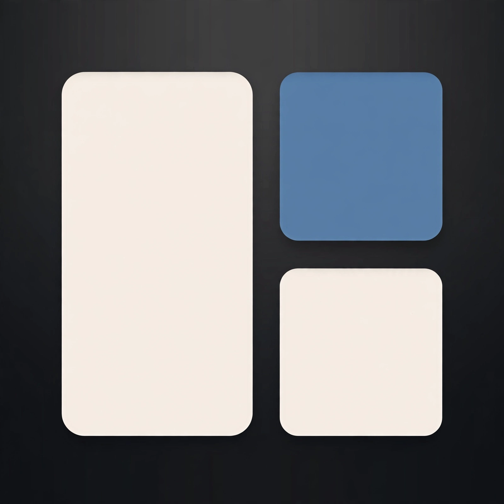

# TileProto

macOS 菜单栏自动窗口平铺：窗口一打开就排进格子，关掉就让旁边的窗口补上。操作只在鼠标和菜单栏面板上，不装全局快捷键。单文件 Swift（`main.swift`），用 `swiftc` 直接编译，不需要 Xcode 工程。

## 它做什么

- **自动平铺**。打开的窗口按当前布局排进格子，关闭或离开后旁边的窗口补位，不留空格。
- **布局**。菜单栏面板上排选布局族：Grid、Columns、Rows、Side；下排选格数上限 1–4（保存值，引擎不改写）。引擎按每格顶的最小尺寸验算，装不下自动降格，超量窗口堆叠进活动格；格子间距固定 8pt。Grid：1 格铺满工作区、2 格左右分、3 格一大两小、4 格 2×2；Columns 是竖列、Rows 是横行、Side 是一大带小；高大于宽的屏强制用 Rows。面板脚注会写明当前屏按最小尺寸装得下几格。每块屏独立平铺。
- **悬停条**。跟当前窗口走，提供四列按钮：Primary、Focus、Float、Pin；同格堆叠的窗口可用悬停条芯片轮换。
  - Primary：与第 0 格顶部窗口互换。
  - Focus：把当前窗口铺满工作区；退出时按进入前的精确帧还原。
  - Float：把当前窗口居中浮动，其余窗口立刻补位；浮动窗的按钮变成 Unfloat，点一下按当前布局排回去。
  - Pin：固定当前窗口（见下面“超格窗口”）。
- **用鼠标改布局**。拖两块格子之间的缝，两侧份额一起变；落点不合要求时整步撤销，不留半格超出的中间态。按住 ⌘拖动：两扇窗口交换位置（整叠对调），或按住 Option 并进一叠；普通拖动不重排，松手弹回原位。
- **超格窗口**。窗口最小尺寸比格子大时：
  - 只要它是前台焦点窗，绝不折叠——盖住邻格也先让它留在眼前。
  - 焦点离开后仍超格，折进 Dock；从 Dock 恢复就是普通恢复，只回来一扇，不连锁折叠其他窗。
  - 后台弹出的非焦点超格窗立即折进 Dock。
  - 点 Pin 固定一扇窗：固定后切走焦点也不折，超格部分一直盖邻格；再点 Unpin，下一轮仍超格且非焦点时再折；对已折叠的窗点固定，先恢复可见再固定。
  - 不再有窄条面板，也不再有“展开一个、其余全折”的手风琴展开。
- **排除**。某个应用不想被平铺：在它最前面时用面板上的 Tile 开关关掉，名单写在 `~/tileproto/excluded.txt`。

## 安装

从 [Releases](https://github.com/longyunBegin/TileProto/releases) 下载 `TileProto-v0.1.0.dmg`，拖到 Applications，打开即可。应用只出现在菜单栏，不占 Dock。

未签名说明：本应用没有 Apple 开发者签名。macOS 首次打开可能报“已损坏”，执行一次即可：

```bash
xattr -cr /Applications/TileProto.app
```

或在 Finder 里右键点击 TileProto.app → 打开，一次之后即可正常启动。

权限：系统设置 → 隐私与安全性 → 辅助功能 + Input Monitoring，添加 `TileProto.app` 并勾选。换二进制后授权一般几秒内自动恢复；个别情况下需要删掉旧条目再重新添加。

## 从源码构建

```bash
git clone https://github.com/longyunBegin/TileProto.git
cd TileProto
./build.sh
open TileProto.app
```

`build.sh` 做三件事：`swiftc -O` 编译 `main.swift`（链接 AppKit 和 ApplicationServices），拷入 `Info.plist`，有 `TileProto.icns` 时拷入 Resources。没有图标也能运行。

## 隐私

- 不读取窗口内容，不保存窗口标题，不联网。
- 日志只记应用名和计数，写在 `~/tileproto/tileproto.log`。
- 学到的最小尺寸只按应用名记在本机偏好里，不上传。
- 不做购买、许可证或云同步。

## 已知限制

- 未签名：每次换二进制都可能需要重新授权（见上）。
- 多显示器按每块屏独立平铺；第二块屏上的鼠标命中尚未充分验证。
- 个别应用最小化提交较慢时，仍可能走兜底（不进折叠集，窗口留在眼前）。
- 有的应用拒绝缩小到格子尺寸：这类窗口按“超格窗口”处理（见上）。
